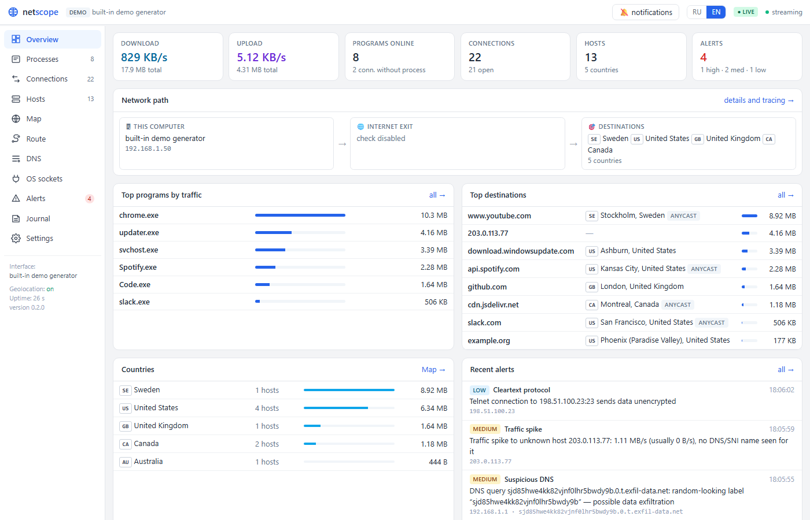
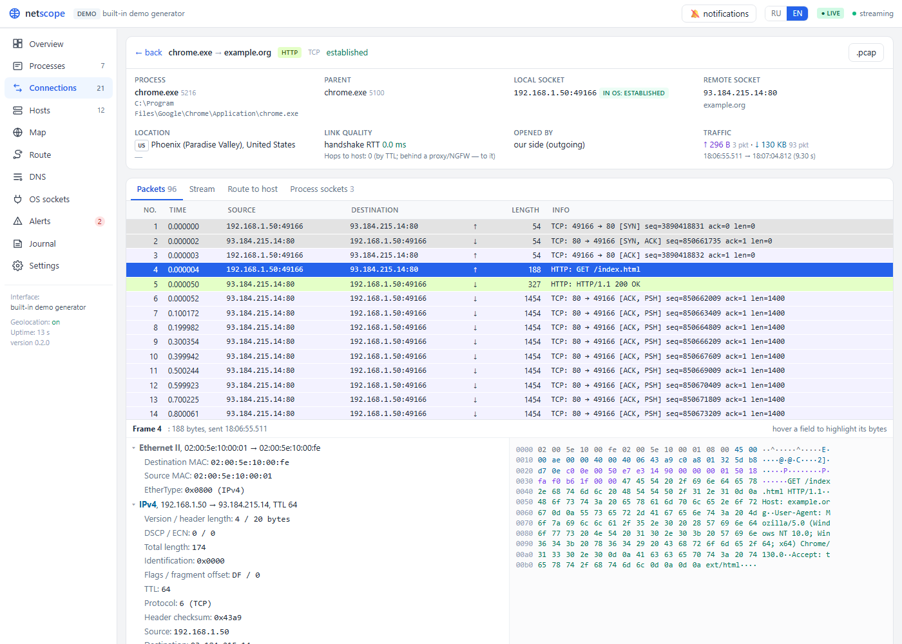
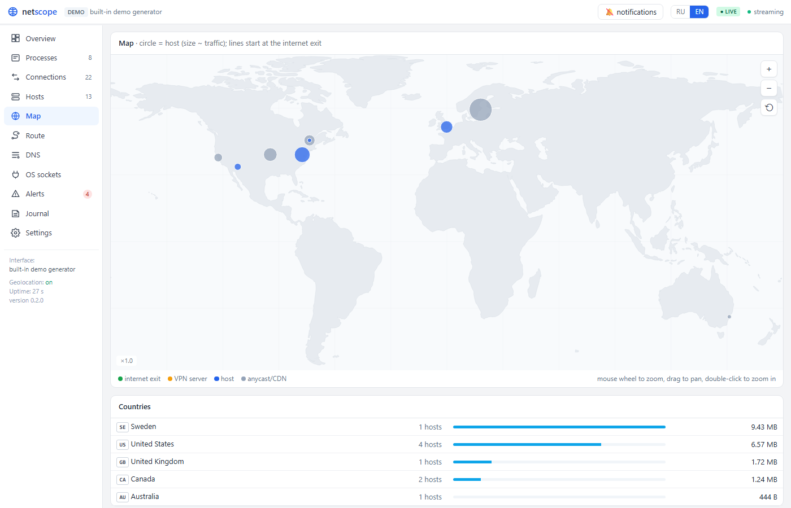
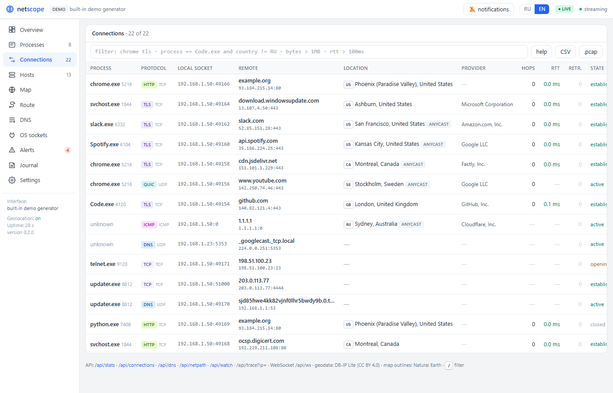
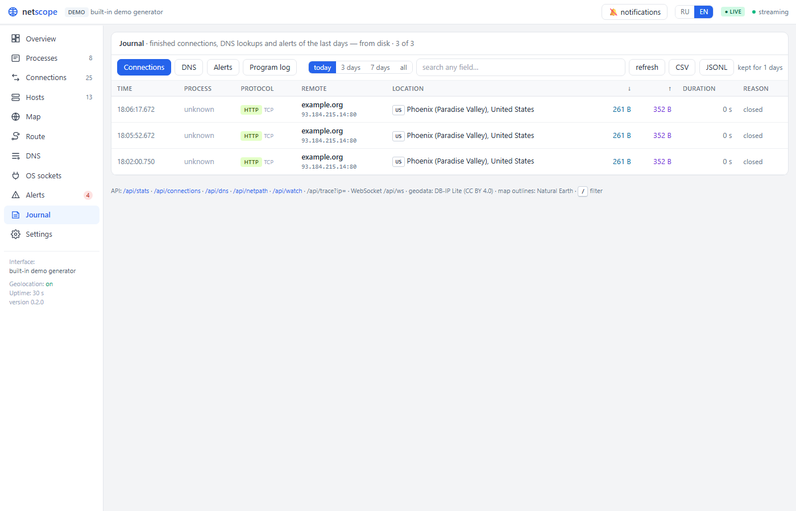
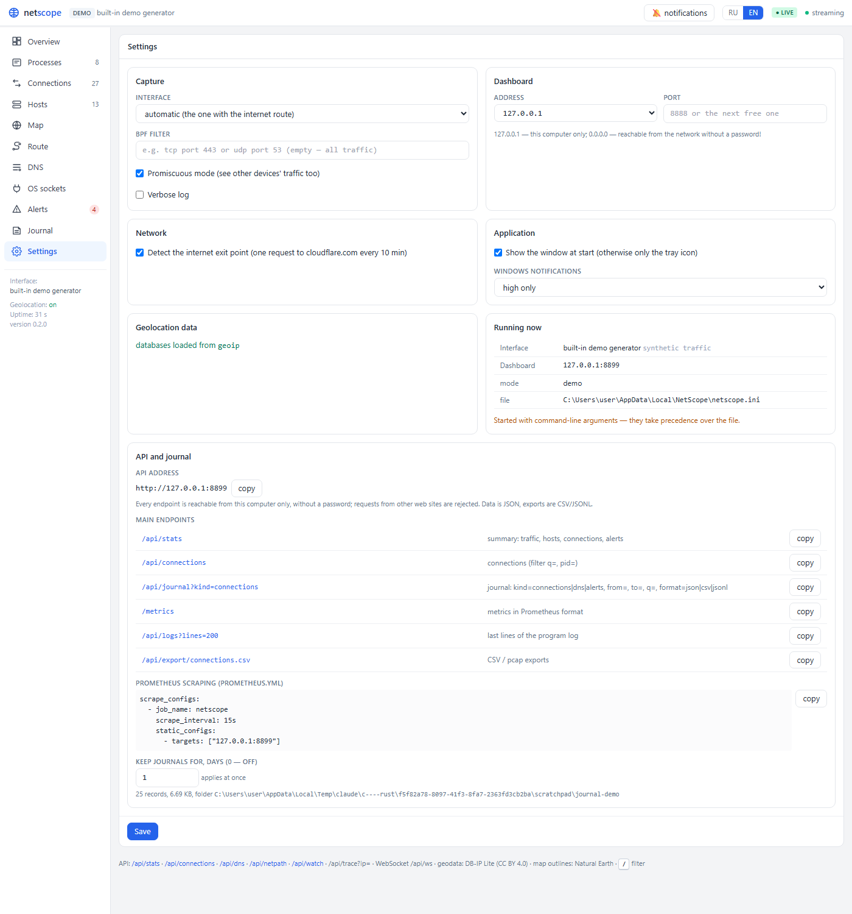
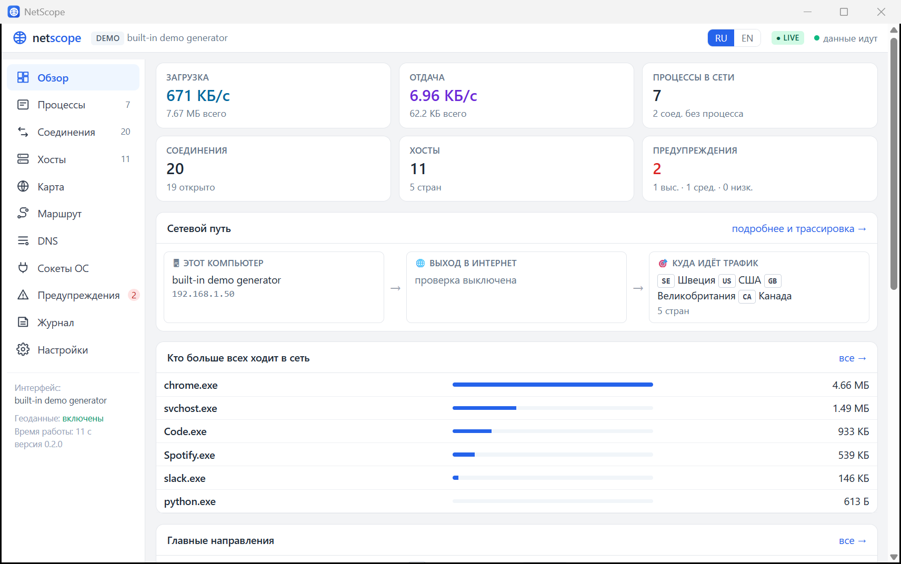
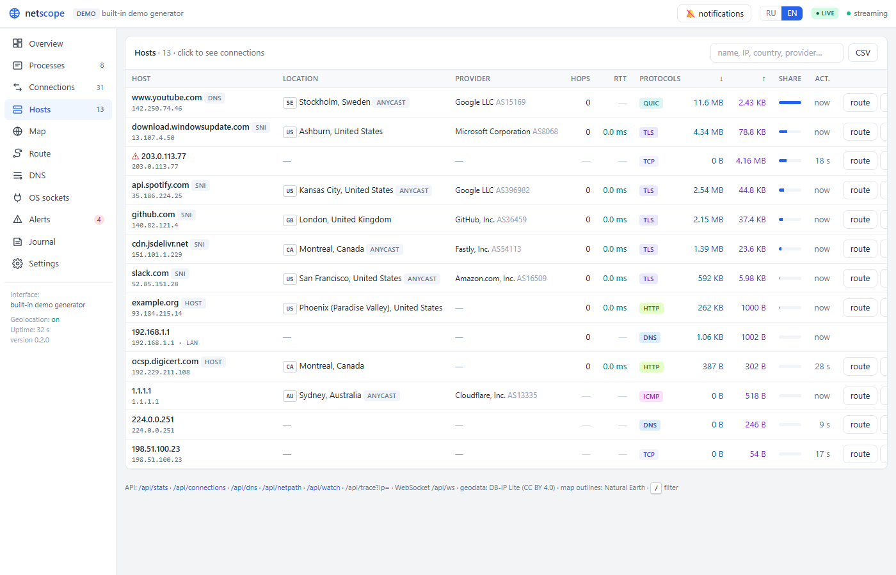
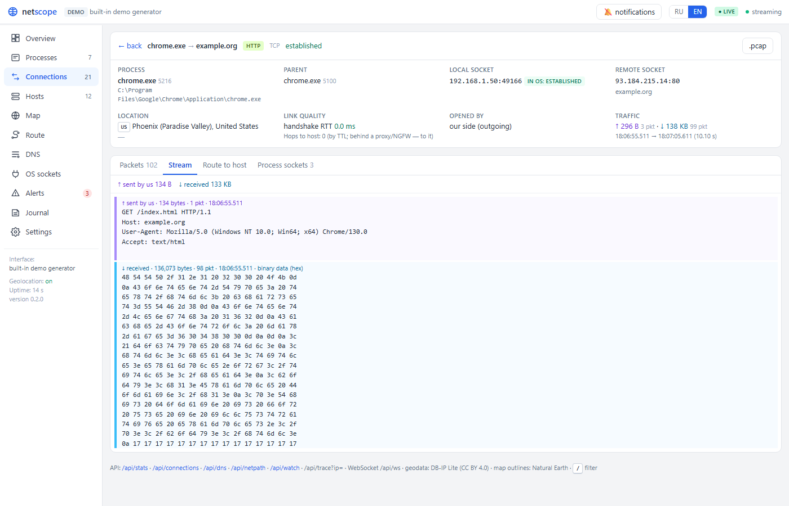
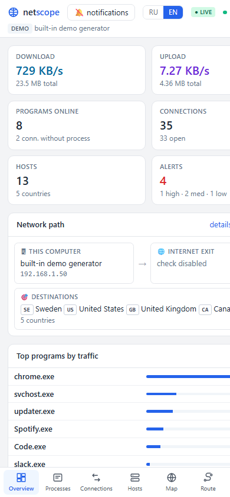

<p align="center"></p>
<h1 align="center">NetScope</h1>
<p align="center"><b>See what your computer talks to.</b><br>
A real-time network traffic analyzer for Windows: every connection attributed to the program that opened it,
packets and streams like in Wireshark, TLS fingerprints, a DNS journal, geolocation on a zoomable map, route tracing,
security alerts, Prometheus metrics and a journal on disk — in one small desktop app, written in Rust.</p>

<p align="center">
<a href="https://github.com/Sobolev5/netscope/releases/latest"></a>


<a href="LICENSE"></a>


</p>

<p align="center"></p>

## Download

Grab the installer from the **[latest release](https://github.com/Sobolev5/netscope/releases/latest)**:

| File | What it is |
|---|---|
| `NetScope-Setup-<version>.exe` (~3 MB) | The program. Downloads the WebView2 runtime and the geolocation databases during setup if they are missing. |
| `NetScope-Setup-<version>-full.exe` (~300 MB) | Everything embedded for machines without internet: the program, the Microsoft Edge WebView2 runtime and the DB-IP Lite geolocation databases. |
| `netscope-<version>-windows-x64.zip` | Portable: `netscope-app.exe` (desktop app), `netscope.exe` (console), `WebView2Loader.dll`, scripts. Unzip and run. |

Live capture needs the **[Npcap](https://npcap.com)** driver (free; its license does not allow bundling it, so the installer
offers to download it — keep *"WinPcap API-compatible Mode"* checked). Without Npcap, NetScope still opens capture files
and runs the demo (`netscope --demo`). The binaries are not code-signed yet, so SmartScreen will ask once: *More info → Run anyway*.

## Highlights

* **Who talks to whom** — every connection attributed to its process (name, path, parent), grouped per program, with
  the remote host named from DNS answers, TLS SNI or HTTP `Host`, its country/city/provider, hops and link quality.
* **Wireshark in the browser** — packet list with one-line summaries, a packet inspector (Ethernet / IP / TCP·UDP /
  DNS·HTTP·TLS fields with byte ranges and a hex dump), follow stream with TCP reassembly, `.pcap` export.
* **Filters** such as `chrome tls`, `process == Code.exe and country != RU`, `bytes > 1MB and not signed`.
* **TLS** — JA4 client fingerprints, SNI/ALPN, server version and cipher, certificate chain (TLS ≤ 1.2).
* **DNS journal**, encrypted DNS (DoH/DoT/DoQ) detection, suspicious-name alerts (tunneling, exfiltration).
* **Alerts** — credentials over HTTP, cleartext protocols, traffic spikes, programs going online for the first time,
  new destinations/countries, new open ports, unsigned programs, route changes, latency increases.
  Shown as Windows notifications by the desktop app.
* **Where traffic goes** — an offline map with zoom and pan, the public exit address, VPN/proxy clients,
  route tracing with watched routes.
* **Journal on disk** — finished connections, DNS lookups and alerts kept for N days (default 1), searchable and
  exportable as CSV/JSONL; **`/metrics`** for Prometheus; a full local JSON API.
* **Settings page** in the app, RU/EN interface, no internet needed for anything but the optional checks.

## Screenshots

| Packet inspector | Map |
|---|---|
|  |  |

| Connections with a filter | Journal |
|---|---|
|  |  |

| Settings and API | The desktop app |
|---|---|
|  |  |

<details><summary>More: hosts, stream, phone layout</summary>




</details>

## Command line

```
netscope                       # capture on the best interface, dashboard on http://127.0.0.1:8888 (next free port if busy)
netscope --open                # same, and open the dashboard in the browser
netscope --demo                # synthetic traffic, no privileges or libpcap needed
netscope -r capture.pcap       # analyze a capture file (add --realtime to replay at original speed)
netscope -l                    # list interfaces
netscope -i 2 -f "tcp port 443 or udp port 53" --host 0.0.0.0 --port 9000
```

## Installing on Windows

`NetScope-Setup-<version>.exe` (from the [releases](https://github.com/Sobolev5/netscope/releases); built by
`scripts\build-installer.ps1`, see [Build](#build)) installs NetScope like any other program — per user without
administrator rights, or for all users when started elevated:

* **NetScope** in the Start menu / on the desktop starts `netscope-app.exe`: a normal program
  window with the dashboard inside (Microsoft Edge WebView2 — part of Windows 11, installed by
  the setup on Windows 10 when missing), no console, an icon in the notification area.
  Closing the window keeps the capture running in the tray; the icon's menu: open NetScope,
  open in the browser, alert notifications (shown as Windows notifications), start with
  Windows, download geolocation data, open the log, quit. A second start brings the window up.
  Without WebView2 the dashboard opens in the default browser instead.
* The installer checks for **Npcap** (the packet capture driver) and offers to download it
  from npcap.com and run its installer — Npcap's license does not allow bundling it. Without
  it the program explains what is missing and where to get it.
* Optional tasks: desktop shortcut, autostart, downloading the **geolocation databases**
  (~140 MB, into `%LOCALAPPDATA%\NetScope\geoip`), allowing the **public IP check** through
  cloudflare.com.
* **Settings** live in `%LOCALAPPDATA%\NetScope\netscope.ini` (`key=value`: `port`, `host`,
  `interface`, `filter`, `geoip`, `egress_check`, `promiscuous`, `verbose`, `show_window`
  (0 = start hidden in the tray), `notifications` (`medium`, `high` or `off`), `journal_days`
  (days of journal kept, 0 = none)). The
  dashboard's **Settings** page (`#/settings`) edits the same file: notifications, the
  window option and the journal retention apply at once; changes to the capture (interface, filter, promiscuous mode),
  the dashboard address or port, the geolocation directory and logging take effect after a
  restart — "Restart now" on the page does it in the desktop app. Command-line arguments to
  `netscope-app.exe` replace the capture settings (the page says so). The log is
  `%LOCALAPPDATA%\NetScope\netscope.log`.
* Uninstalling stops the program, removes the files, shortcuts and the autostart entry; the
  settings and geolocation data in `%LOCALAPPDATA%\NetScope` stay unless deleted by hand.

The dashboard needs no internet: its styles, the map outlines and the geolocation
databases are local, and nothing but the optional egress check leaves the machine.

## Processes, connections and packets

Every connection is attributed to the **process that owns its local socket**, read
from the OS socket table about once a second (and right away when a new connection
appears): Windows `GetExtendedTcpTable`/`GetExtendedUdpTable` + Toolhelp, Linux
`/proc/net/*` + `/proc/<pid>/fd` (root or `CAP_SYS_PTRACE` to see other users'
processes), macOS `lsof`. The dashboard drills down:

* **Processes** — executable, path, parent, traffic, destinations (helpers such as the
  many `Code.exe` processes are grouped)
* **Connections** — local socket ↔ remote socket, TCP state, who opened it, bytes/packets each way
* **Connection** — the process' other OS sockets, the last 200 packets with a
  Wireshark-style one-line summary, a **packet inspector** (Ethernet / IP / TCP·UDP /
  DNS·HTTP·TLS fields with byte ranges + hex dump) and **follow stream**
  (TCP reassembled by sequence number; TLS/QUIC payloads stay encrypted)
* **OS sockets** — the full kernel socket table with owners

Deep links: `#/conn/<id>?pkt=<n>` opens a packet, `#/conn/<id>?tab=stream` the stream.
Memory: 4096 connections, 200 packets each, 96 MiB of stored frames at most.

## Investigation features

* **Filter language** (Connections page and `GET /api/connections?q=`), Wireshark-like:
  `chrome tls`, `process == Code.exe and country != RU`, `bytes > 1MB and not signed`,
  `rtt > 150ms or retrans > 5`, `country in {US, DE}`, `ip == 140.82.*`, `doh`.
  Fields: process, pid, path, app, l4, name, ip, port, lport, country, city, org, asn, anycast,
  state, dir, bytes, in, out, packets, rtt, retrans, hops, tls, alpn, ja4, signed, doh
  (`GET /api/filter/fields` lists aliases). Syntax errors come back with their position.
* **"First seen" alerts** (after a 60 s learning period): a program going online for the
  first time, contacting a new domain/provider or a new country, a new port reachable from
  the network. Browser notifications can be switched on in the header.
* **Code signatures** of every program that uses the network (Authenticode via
  `Get-AuthenticodeSignature` on Windows, `codesign` on macOS); unsigned programs — especially
  from Temp/Downloads — raise alerts.
* **TLS**: JA4 client fingerprint, SNI, ALPN and offered version for every handshake; server
  version, cipher and (TLS ≤ 1.2) the certificate chain. The first 32 packets of every
  connection are always kept, so handshakes stay readable for long downloads.
* **DNS journal**: every query with answer, latency, resolver and the program that then
  connected to the answer; DoH/DoT/DoQ connections that hide lookups are listed.
* **Link quality**: TCP handshake RTT, retransmissions and zero-window events per connection
  and host.
* **Map** of hosts, the egress point and VPN servers (Natural Earth outlines are embedded):
  mouse wheel / pinch to zoom, drag to pan, double-click to zoom in; host names appear when
  zoomed in. The route of a traceroute is drawn on the same map.
* **Watched routes**: chosen hosts are traced every 10 minutes; path changes (other
  providers/countries) and slowdowns raise alerts.
* **Exports**: CSV of connections (respects the filter), hosts, processes, DNS; `.pcap` of one
  connection or of every connection matching a filter — opens in Wireshark.
* **Journal**: finished connections, DNS lookups and alerts are appended to
  `<data dir>/journal/{connections,dns,alerts}-YYYY-MM-DD.jsonl` (one JSON object per line,
  UTC days) during live capture, so what happened before the dashboard was opened — or
  before the restart — can still be read. A connection is written once: when it is seen
  closed, when it is dropped from memory, or at exit (`reason`: `closed`, `evicted`,
  `shutdown`). Files older than `journal_days` (default 1, `--journal-days N`, 0 = off) are
  deleted hourly; `--journal-dir DIR` moves the files (and makes `--demo`/`--read` write
  them too), `--no-journal` switches the journal off. Query and download the journal with
  `GET /api/journal` (JSON, JSON lines or CSV), see the API table.
* **Prometheus** `/metrics`: traffic, connection, alert, DNS, per-program and per-country
  counters (see [API](#api)).
* **Languages**: Russian and English (switch in the header; `?lang=en` in the URL).

## Where traffic goes: geolocation, egress, route

* **Geolocation and provider** for every remote address from the free DB-IP Lite
  databases (city + ASN, CC BY 4.0), read offline by a built-in MaxMind DB reader —
  no address leaves the machine. Download them once:
  `powershell -ExecutionPolicy Bypass -File scripts\fetch-geoip.ps1` (or `scripts/fetch-geoip.sh`),
  files land in `geoip/`; `--geoip <dir>` points elsewhere (also searched: next to the binary,
  `%LOCALAPPDATA%\NetScope\geoip`, `%PROGRAMDATA%\NetScope\geoip`, `~/.local/share/netscope/geoip`).
  Country and city names come in English and, for the Russian UI, in Russian. Anycast/CDN
  networks are marked: their "location" is one of many.
* **Hop estimate** per host and connection from the TTL of received packets (no probes).
  Behind a proxy/NGFW that terminates TCP this is the distance to the proxy.
* **Egress address**: one plain HTTP request to Cloudflare's `/cdn-cgi/trace` every 10 minutes
  shows the public IP the internet sees (`--no-egress-check` disables it).
* **VPN / proxy clients** (AnyConnect, WireGuard, OpenVPN, Tailscale, Happ, v2ray/xray...) are
  recognized in the OS socket table, with their servers' location.
* **Route tracing** on demand (Маршрут page, or "Маршрут до хоста" in a connection): ICMP probes
  with TTL 1…30 — `IcmpSendEcho` on Windows (no admin rights), the system `traceroute` on
  Linux/macOS — every hop with RTT, reverse DNS, provider and country; border crossings are marked.

## Architecture

```
capture thread (std::thread)                     tokio runtime
┌───────────────────────────────┐               ┌──────────────────────────────────────┐
│ libpcap/Npcap (loaded at      │   decode →    │ publisher: 1 snapshot/s → watch chan │
│ runtime) | .pcap reader | demo│── record() ──►│ GET /           embedded dashboard   │
└───────────────────────────────┘   Arc<RwLock<State>>  GET /api/stats | /api/alerts      │
                                                │ GET /api/health  WS /api/ws (push)  │
                                                └──────────────────────────────────────┘
```

| Module | Responsibility |
|---|---|
| `capture/` | `ffi` (libpcap symbols via `libloading`), `live` (devices, live/offline handles, interface choice), `file` (built-in pcap reader/writer), `engine` (capture thread) |
| `decode/` | etherparse (lax) for L2–L4; hand-written DNS, TLS SNI and HTTP parsers |
| `analytics/` | `State` (hosts, names, protocols, bandwidth history), anomaly detectors, JSON snapshot |
| `web/` | axum router, REST, WebSocket, graceful shutdown; `css` generates the utility stylesheet the page uses (a Tailwind subset — no CDN) |
| `demo/` | scripted synthetic traffic that exercises every detector |
| `procs/`, `geo/`, `trace/`, `netpath` | process attribution and code signatures, MaxMind DB reader, route tracing and watching, egress check |
| `app`, `cli`, `main.rs` | wiring and the command-line program; `app::run_with` takes an external shutdown signal |
| `src/bin/app/` | Windows desktop shell: program window hosting the dashboard (`webview.rs` — WebView2 through `WebView2Loader.dll`, COM declared by hand), tray icon, notifications, settings and log files, single instance |
| `assets/index.html` | single-file dashboard (`include_str!`): written with Tailwind class names, styled by `web::css` |
| `installer/netscope.iss` | Inno Setup script; `scripts/build-installer.ps1` builds `dist\NetScope-Setup-<version>.exe` |

libpcap is resolved **at runtime** instead of linked: the build needs no pcap SDK,
and a machine without Npcap/libpcap gets an explanation instead of a crash
(`NETSCOPE_LIBPCAP=/path/to/lib` overrides the search).

### Detectors

| Alert | Severity | Trigger |
|---|---|---|
| Credentials over HTTP | high | unencrypted HTTP request containing `password`, tokens, API keys, `Authorization: Basic/Bearer`, card data… |
| Suspicious DNS | medium / low | names > 100 chars, labels > 50 chars, high-entropy labels with digits (tunneling/exfiltration); TXT/NULL/ANY queries |
| Volume spike | medium / high | an external host **with no DNS/SNI/Host name** exchanges > `--spike-mib` MiB (default 1) in one second and > 8× its usual rate |
| Cleartext protocol | low | new FTP, Telnet, POP3, IMAP, rexec, rlogin connections |

Repeats of the same alert are suppressed for 60 s. Memory is bounded (4096 hosts LRU, 500 alerts, 5 min of history).

## Build

Requires Rust 1.82+.

```sh
cargo build --release          # binaries: target/release/netscope (+ netscope-app on Windows)
cargo test                     # unit + integration tests (no privileges needed)
```

Windows installer (needs [Inno Setup 6.1+](https://jrsoftware.org/isdl.php); `ISCC.exe` is
found in `PATH`, `%ISCC%` or the usual install folders):

```powershell
powershell -ExecutionPolicy Bypass -File scripts\build-installer.ps1         # → dist\NetScope-Setup-<version>.exe
powershell -ExecutionPolicy Bypass -File scripts\build-installer.ps1 -Full   # → …-full.exe with WebView2 + geodata embedded
```

`-Full` downloads the WebView2 Evergreen standalone installer and the DB-IP Lite databases once into
`installer\redist\` and embeds them, for machines without internet access.

On Windows `build.rs` embeds the icon and version block with the toolchain's resource
compiler (`windres` / `rc.exe`); without one the build still works, just without an icon.

Runtime dependency for live capture / pcapng files:

| OS | Install |
|---|---|
| Linux | `sudo apt install libpcap0.8` (Debian/Ubuntu) · `sudo dnf install libpcap` · `apk add libpcap` |
| macOS | built in |
| Windows | [Npcap](https://npcap.com) — keep *"WinPcap API-compatible Mode"* checked |

Classic `.pcap` files and `--demo` work without libpcap.

## Capture permissions

**Linux** — give the binary the two capabilities once instead of running it as root:

```sh
sudo setcap cap_net_raw,cap_net_admin=eip target/release/netscope
getcap target/release/netscope     # verify
```

Capabilities are dropped when the file is rewritten, so repeat after every `cargo build`.

**macOS** — either `sudo ./target/release/netscope`, or grant your user access to the
BPF devices (persistently via Wireshark's *ChmodBPF* package, or until reboot):

```sh
sudo chgrp admin /dev/bpf* && sudo chmod g+rw /dev/bpf*
```

**Windows** — install Npcap. If it was installed with *"Restrict Npcap driver's access
to Administrators only"*, run the terminal as Administrator (or reinstall without that
option). Building with the `x86_64-pc-windows-gnu` toolchain also needs a full MinGW
(e.g. WinLibs) on `PATH`; the MSVC toolchain needs nothing extra.

## API

| Endpoint | |
|---|---|
| `GET /api/stats?hosts=50&alerts=100` | full snapshot (JSON); without parameters returns the cached one |
| `GET /api/alerts` | all retained alerts plus counts |
| `GET /api/health` | `{"status":"ok","version":"…","capture":{...},"now":...}` |
| `GET /api/processes` | traffic per process |
| `GET /api/connections?pid=&q=&limit=` | connections, newest first (`pid=0`: without a process) |
| `GET /api/connections/{id}` | connection, its packets and the process' sockets |
| `GET /api/connections/{id}/packets/{n}` | dissected packet with hex bytes |
| `GET /api/connections/{id}/stream` | reassembled payload in conversation order |
| `GET /api/sockets?pid=` | OS socket table with owners |
| `GET /api/netpath` | egress address, VPN tunnels, traffic per country |
| `GET /api/trace?ip=&fresh=` | trace the route to an address (cached 5 min) |
| `GET /api/geo?ip=` | location and provider of an address |
| `GET /api/dns?q=&limit=` | DNS journal and encrypted-DNS connections |
| `GET /api/filter/fields` | filter field names and aliases |
| `GET/POST/DELETE /api/watch?ip=&label=` | watched routes and their history |
| `GET /api/export/{connections,hosts,processes,dns}.csv` | CSV exports (`connections` takes `q=`, `pid=`) |
| `GET /api/export/connections.pcap?q=` | stored packets of matching connections |
| `GET /api/connections/{id}/pcap` | stored packets of one connection |
| `GET /api/journal?kind=connections\|dns\|alerts&from=&to=&q=&limit=&format=json\|jsonl\|csv` | journal records, newest first: `{"kind","from","to","total","records":[…]}`; `from`/`to` unix seconds (default: the kept days), `q` case-insensitive text search, `limit` ≤ 5000 (default 500); `jsonl`/`csv` are downloads |
| `GET /api/journal/stats` | journal files per day (`{"dir","days":[{"date","records":{"connections","dns","alerts"},"bytes"}],"bytes_total","days_kept","enabled","pending","dropped"}`) |
| `GET /api/logs?lines=200` | the end of the program's log file (`{"file","lines"}`; `file` is `null` for the CLI, which logs to the console), at most 5000 lines |
| `GET /api/settings` · `POST /api/settings` | the settings file, what is active, `journal` (`dir`, `days`, `enabled`) and `api` (`base`, `metrics`); `POST` saves a patch (`journal_days` applies at once) |
| `GET /metrics` | Prometheus text exposition (not under `/api`, same `Host`/`Origin` checks) |
| `WS /api/ws` | pushes the snapshot every second |

Errors come back as `{"error":{"code":"bad_request|not_found|rate_limited|limit|filter|internal","message":"…"}}`
(filter errors add `position`). The dashboard has no authentication: binding to anything but
loopback logs a warning; requests from other web pages are rejected (`Host`/`Origin` checks).

`/metrics` exposes `netscope_build_info{version}`, `netscope_up`, `netscope_uptime_seconds`,
`netscope_bytes_total{direction}`, `netscope_packets_total{direction}`,
`netscope_rate_bytes_per_second{direction}`, `netscope_connections{state="active|closed|total"}`,
`netscope_hosts`, `netscope_alerts_total{severity}`, `netscope_dns_queries_total`,
`netscope_dns_failures_total`, `netscope_process_bytes_total{process,direction}` (top 50
programs), `netscope_country_bytes_total{country_code}`, `netscope_journal_records_total{kind}`
and `netscope_journal_pending`. A scrape job for `prometheus.yml`:

```yaml
scrape_configs:
  - job_name: netscope
    static_configs:
      - targets: ["127.0.0.1:8888"]
```

## Credits

Built by [Andrey Sobolev](https://github.com/Sobolev5) together with [Claude](https://claude.com) (Anthropic).
Geolocation data: [DB-IP Lite](https://db-ip.com) (CC BY 4.0). Map outlines: [Natural Earth](https://www.naturalearthdata.com).
Packet capture: [Npcap](https://npcap.com) / libpcap. Dashboard engine: Microsoft Edge WebView2.
